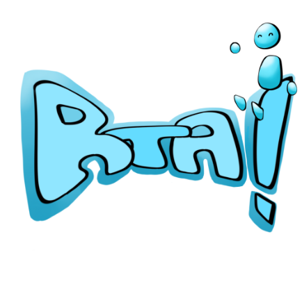

  

# Rivals Through Ages 

**Juegos en Red · Grado en Diseño y Desarrollo de Videojuegos · URJC · Curso 2026/27** 
**Grupo G**

## Descripción de la temática

Rivals Through Ages es un juego de pealeas en 2D para dos jugadores en red en el que se tendrán que pelear para ser el último en pie. Ambientado en varias epocas, los jugadores deben usar las armas que aparezcan para poder vencer a su oponente.

## Equipo de desarrollo

| Nombre y apellidos | Correo URJC | GitHub |
| :--- | :--- | :--- |
| Leila Aabbouz Chillada | l.aabbouz.2024@alumnos.urjc.es | `https://github.com/leleleila` |
| Genma de Argüeso Muñoz | g.deargueso.2024@alumnos.urjc.es | `https://github.com/genmita` |
| Iván Domingo Reyes |  i.domingo.2024@alumnos.urjc.es | `https://github.com/iviDoRe` |
| Aimar Hernández Holgado | a.hernandezh.2024@alumnos.urjc.es | `https://github.com/AimarHH ` |

**Repositorio:** `https://github.com/leleleila/Practica-Juegos-en-Red`

**Licencia:** [Apache 2.0](LICENSE)

---

## Game Design Document

📄 El documento de diseño completo está en **[GDD.md](GDD.md)**.

Apartados principales:

- [Especificaciones básicas](GDD.md#2-especificaciones-básicas)
- [Jugabilidad](GDD.md#3-jugabilidad)
- [Narrativa](GDD.md#4-narrativa)
- [Imagen y diseño visual](GDD.md#5-imagen-y-diseño-visual)
- [Sonido](GDD.md#6-sonido)
- [Interfaz y diagrama de flujo](GDD.md#7-interfaz-y-diagrama-de-flujo)
- [Comunicación y marketing](GDD.md#8-comunicación-y-marketing)
- [Referencias](GDD.md#9-referencias)

---

## Fases del proyecto

| Fase | Contenido | Estado |
| :--- | :--- | :--- |
| Fase 1 | Equipo, temática y GDD | ✅ Entregada (tag `fase-1`) |
| Fase 2 | Juego en local | ⏳ Pendiente |
| Fase 3 | API REST | ⏳ Pendiente |
| Fase 4 | WebSockets | ⏳ Pendiente |
